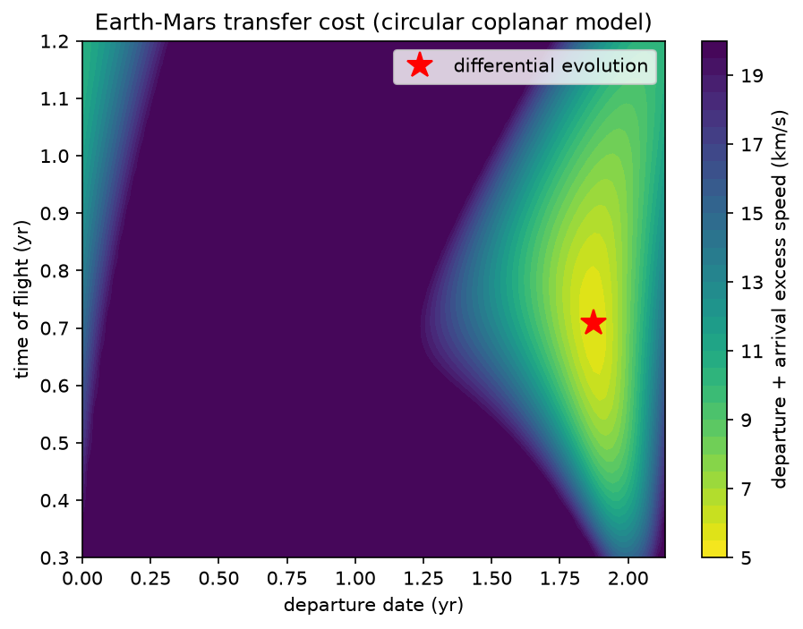

# Numerical methods for orbital mechanics

Kepler integrators, Adams-type multistep methods and global trajectory optimisation, in Python.

A comparison of numerical integrators applied to the Kepler problem, rewritten in Python from the MATLAB programs developed for my M.Sc. thesis in Mathematics on symplectic integrators, and extended with the Adams-type multistep methods of a numerical analysis course.

Implemented methods:

- Explicit Euler (order 1)
- Symplectic Euler (order 1)
- Implicit midpoint (order 2), solved with `scipy.optimize.fsolve`
- Störmer–Verlet (order 2)
- Adams–Bashforth, 1 to 4 steps (order 1 to 4)
- Adams–Moulton, 1 to 4 steps (order 2 to 5), implicit equation solved by fixed-point iteration
- ABM4 predictor–corrector in PECE form (order 5)

## Problem

Kepler problem in normalised units (mu = 1, semi-major axis a = 1) with eccentricity e = 0.7, starting from pericentre. The state is y = (x, y, vx, vy). The conserved quantities are the energy E = -0.5 and the angular momentum L = sqrt(1 - e^2). The reference solution is computed with `scipy.integrate.solve_ivp` (DOP853, tolerances 1e-13).

## Structure

- `kepler.py`: force, initial state, energy, angular momentum, the four integrators, `integrate` and the reference solution.
- `convergence.py`: convergence study. Computes the global error at t = 3 for several step sizes, estimates the observed order with a log-log fit and saves `figures/convergence.png`.
- `orbits.py`: orbit comparison for e = 0.7; saves `figures/orbits.png`.
- `multistep.py`: Adams–Bashforth, Adams–Moulton and ABM4 (PECE) multistep methods.
- `multistep_convergence.py`: observed orders of the multistep methods on the Kepler problem.
- `multistep_orbits.py`: Kepler orbits computed with the multistep methods.
- `local_optimisation.py`: Newton and gradient methods (steepest descent, conjugate gradient, least squares) for unconstrained minimisation, tested on the Rosenbrock function
- `trajectory_optimisation.py`: global optimisation of an Earth–Mars transfer (Lambert solver and differential evolution); saves `figures/porkchop.png`.
- `compare_local_global.py`: comparison of a local method (L-BFGS-B from random starting points) with differential evolution on the Earth–Mars cost
- `parallel_speedup.py`: strong-scaling test of the search with several worker processes; saves `figures/speedup.png`.
- `tests/test_kepler.py`, `tests/test_multistep.py`, `tests/test_trajectory_optimisation.py`,`tests/test_local_optimisation.py`, `tests/test_compare_local_global.py`, `tests/test_parallel_speedup.py`: automated tests with pytest.
- `requirements.txt`: required libraries.

## Usage

```
python3 -m venv .venv
source .venv/bin/activate
pip install -r requirements.txt
python3 convergence.py
python3 orbits.py
pytest -v
```

## Results

### Convergence

Observed convergence orders (global error at t = 3):

| Method | Observed order |
|---|---|
| Explicit Euler | 1.00 |
| Symplectic Euler | 0.97 |
| Implicit midpoint | 2.00 |
| Störmer–Verlet | 2.00 |


Note: explicit Euler uses much smaller steps (20,000 to 160,000 steps) than the other methods, because with few steps it is not in the asymptotic regime and the observed order is underestimated.

### Multistep methods

`multistep.py` adds Adams-type linear multistep methods: Adams–Bashforth (1 to 4 steps, order 1 to 4), Adams–Moulton (1 to 4 steps, order 2 to 5, implicit equation solved by fixed-point iteration) and the predictor–corrector scheme ABM4 in PECE form (AB4 predictor, AM4 corrector). Starting values are computed with DOP853.

The observed orders on the test problem y' = -y, y(0) = 1 match the theoretical ones (checked by `tests/test_multistep.py`). On the Kepler problem (e = 0.7, global error at t = 3, `multistep_convergence.py`) the observed orders are:

| Method | AB1 | AB2 | AB3 | AB4 | AM1 | AM2 | AM3 | AM4 | ABM4 (PECE) |
|---|---|---|---|---|---|---|---|---|---|
| Observed order | 0.95 | 1.99 | 2.93 | 3.97 | 2.00 | 2.95 | 3.98 | 4.52 | 5.09 |

The value for AM4 is below the theoretical 5 because, for the smallest steps, its error approaches the accuracy of the DOP853 reference solution. With 1,000 steps, ABM4 (PECE) reaches an error of about 6e-8, against about 1.5e-5 for AB4.


Orbits computed with a deliberately coarse step (2 periods, 1,000 steps, `multistep_orbits.py`) show the differences in accuracy. The error at the final time ranges from 4.2 for AB1 and 2.7 for AB2, whose orbits lose their shape, to 2.3e-2 for AM3, 8.4e-3 for ABM4 (PECE) and 5.7e-4 for AM4, which follow the reference orbit closely. At equal order, the implicit Adams–Moulton methods are more accurate than the explicit Adams–Bashforth ones.


These methods were first implemented in MATLAB for a joint assignment of the Scientific Computing course (2023/24) and are rewritten here from the formulas.

### Global trajectory optimisation (differential evolution)

`trajectory_optimisation.py` searches the departure date and time of flight of an
Earth-Mars transfer with `scipy.optimize.differential_evolution`. The model is
simplified (circular coplanar planets, two-body dynamics, Lambert problem solved
with universal variables). The minimum found, 5.594 km/s, matches the Hohmann
transfer, which validates the Lambert solver and the search.



`parallel_speedup.py` measures the strong scaling of the search with an increasing
number of worker processes. To mimic a more expensive model, the cost function is
evaluated 20 times per call (`REPS = 20`, artificial load). On a MacBook Pro with
10 cores the speedup is 1.89, 3.67 and 5.93 with 2, 4 and 8 processes (efficiency
0.94, 0.92 and 0.74). The scaling is consistent with Amdahl's law with an effective
parallel fraction of 0.95, which includes the cost of starting the processes and of
moving data.


References: Curtis, *Orbital Mechanics for Engineering Students* (Lambert's problem);
Storn and Price, J. Global Optimization 11 (1997), 341-359; Virtanen et al.,
Nature Methods 17 (2020), 261-272.

### Local versus global search

`compare_local_global.py` runs a local method (`scipy.optimize.minimize`,
L-BFGS-B with finite-difference gradients) from 100 random starting points on
the Earth-Mars cost, and compares it with differential evolution.

| Method | Reaches the 5.594 km/s minimum | Evaluations |
|---|---|---|
| L-BFGS-B, 100 random starts | 57 of 100 | about 80 per run |
| Differential evolution | always (4 seeds) | 6000-12000 per run |

The local method is much cheaper but depends on the starting point; the worst
run ends at 10.47 km/s. Differential evolution costs more evaluations and finds
the minimum from any seed. The local method here is SciPy's, not the one from
`local_optimisation.py`, because the cost function has no analytic gradient or Hessian.

### Local optimisation (Newton and gradient methods)

`local_optimisation.py` is a Python version of the methods from the
Scientific Computing labs 7-9 (a joint assignment, originally written in MATLAB):
Newton, Newton with Armijo backtracking, steepest descent with Armijo
backtracking, steepest descent with exact line search, conjugate gradient
(the last two for symmetric positive definite linear systems) and conjugate
gradient for least squares problems.

On the Rosenbrock function from (-1.2, 1), tolerance 1e-6 on the gradient norm:

| Method | Iterations |
|---|---|
| Newton | 6 |
| Newton + Armijo, step never reset | 174 |
| Newton + Armijo, step reset to 1 at every iteration | 21 |
| Steepest descent + Armijo | 32847 |

A local method needs a good starting point; the global search above
(differential evolution) does not.

### Orbits

Orbits obtained with e = 0.7, 5 orbits and 200 steps per orbit, compared with the exact ellipse (dashed). All start from pericentre.


With this relatively coarse step:

- **Explicit Euler** diverges: the energy grows at every step and the orbit opens up until it leaves the ellipse.
- **Symplectic Euler** stays bounded, but the numerical orbit is distorted with respect to the exact ellipse.
- **Implicit midpoint** keeps the shape and size of the ellipse, but the major axis rotates at every revolution (a phase error, absent in the exact problem).
- **Störmer–Verlet** is the closest to the exact orbit, with a very small precession.

Symplectic and symmetric methods do not show the systematic energy drift of explicit Euler: the dominant error is a phase error, and the energy stays bounded.

## Tests

The repository has 29 automated tests (`pytest`): orders of convergence of the integrators, multistep methods, the Lambert problem and global optimisation, the parallel speedup experiment, the local optimisation methods and the local versus global comparison. They run on every push with GitHub Actions.

## Possible extensions

- Systematic comparison with the results of the original MATLAB programs.
- Study of other eccentricities and longer integration times.
- Planar circular restricted three-body problem.