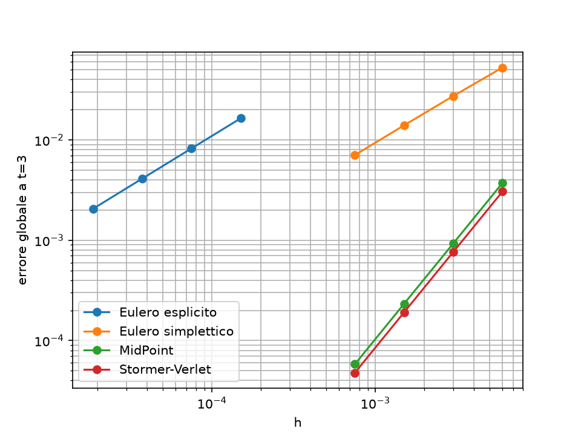

# Integratori numerici per il problema di Keplero

Confronto di quattro integratori numerici applicati al problema di Keplero, riscritti in Python a partire dai programmi MATLAB sviluppati per la tesi magistrale in Matematica sugli integratori simplettici.

Metodi implementati:

- Eulero esplicito (ordine 1)
- Eulero simplettico (ordine 1)
- Punto medio implicito (ordine 2), risolto con `scipy.optimize.fsolve`
- Störmer–Verlet (ordine 2)

## Problema

Problema di Keplero in unità normalizzate (mu = 1, semiasse maggiore a = 1) con eccentricità e = 0.7, partendo dal pericentro. Lo stato è y = (x, y, vx, vy). Le quantità conservate sono l'energia E = -0.5 e il momento angolare L = sqrt(1 - e^2). La soluzione di riferimento è calcolata con `scipy.integrate.solve_ivp` (metodo DOP853, tolleranze 1e-13).

## Struttura

- `kepler.py`: forza, stato iniziale, energia, momento angolare, i quattro integratori, `integrate` e soluzione di riferimento.
- `convergence.py`: studio di convergenza. Calcola l'errore globale a t = 3 per diversi passi, stima l'ordine osservato con un fit in scala log-log e salva `convergenza.png`.
- `tests/test_kepler.py`: test automatici con pytest.
- `requirements.txt`: librerie usate.

## Uso

```
python3 -m venv .venv
source .venv/bin/activate
pip install -r requirements.txt
python3 convergence.py
pytest -v
```

## Risultati

Ordini di convergenza osservati (errore globale a t = 3):

| Metodo | Ordine osservato |
|---|---|
| Eulero esplicito | 1.00 |
| Eulero simplettico | 0.97 |
| Punto medio implicito | 2.00 |
| Störmer–Verlet | 2.00 |



Nota: Eulero esplicito usa passi molto più piccoli (da 20000 a 160000 passi) degli altri metodi, perché con pochi passi non si trova nel regime asintotico e l'ordine osservato risulta sottostimato.

## Test

I cinque test automatici verificano:

- energia e momento angolare dello stato iniziale rispetto ai valori teorici;
- ordine 2 di Störmer–Verlet e ordine 1 di Eulero simplettico, entro una tolleranza;
- conservazione del momento angolare con Störmer–Verlet su 10 orbite;
- energia limitata (errore sotto 1e-3) con Störmer–Verlet su 100 orbite.

## Sviluppi possibili

- Confronto sistematico con i risultati dei programmi MATLAB originali.
- Studio di orbite con eccentricità diverse e di tempi di integrazione più lunghi.
- Problema dei tre corpi ristretto circolare planare.