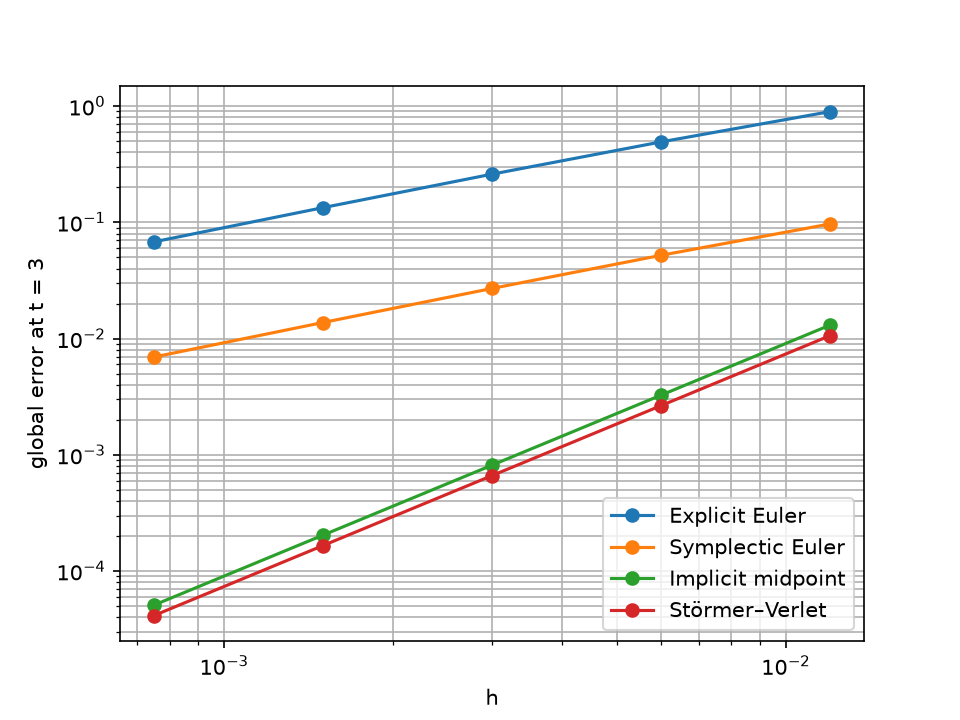
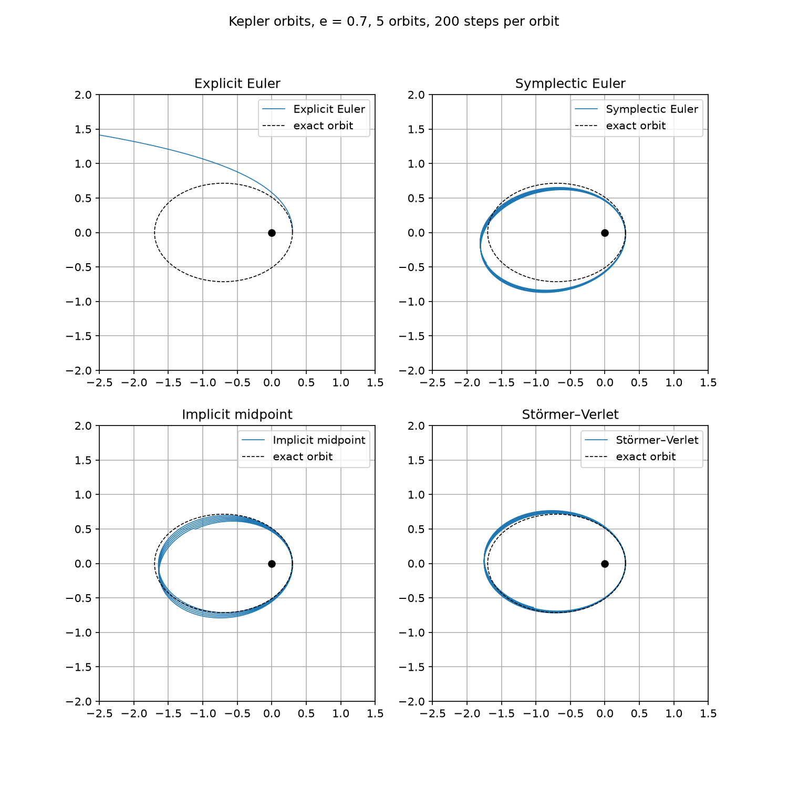
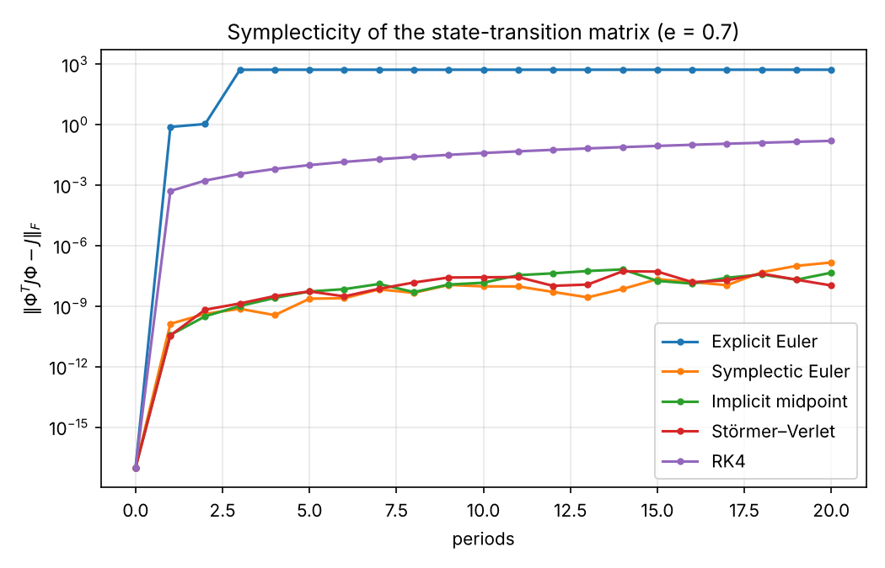
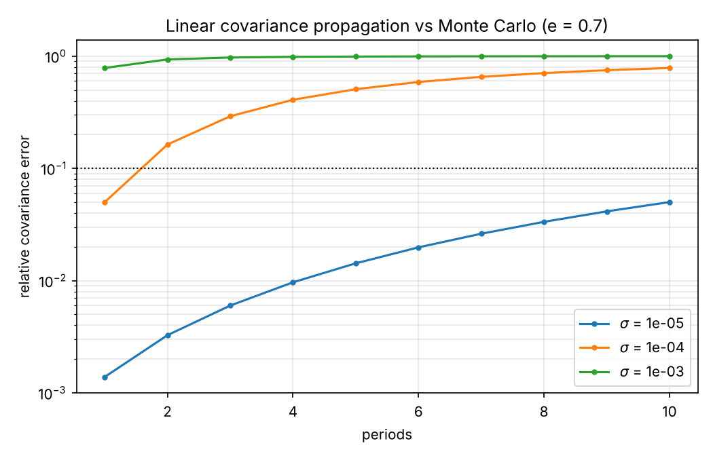
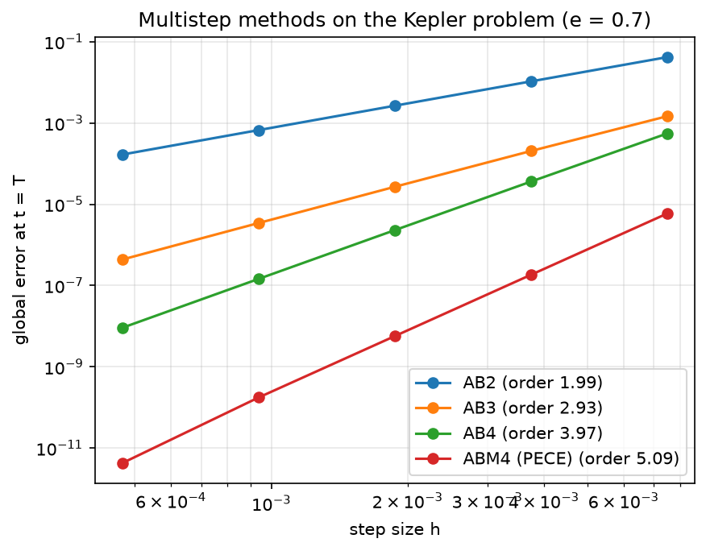
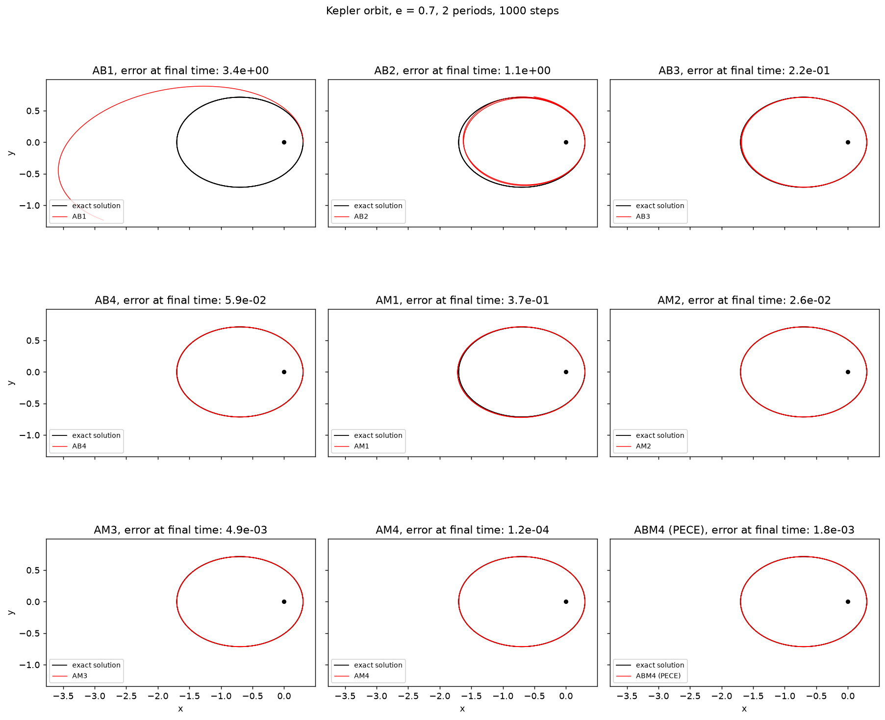
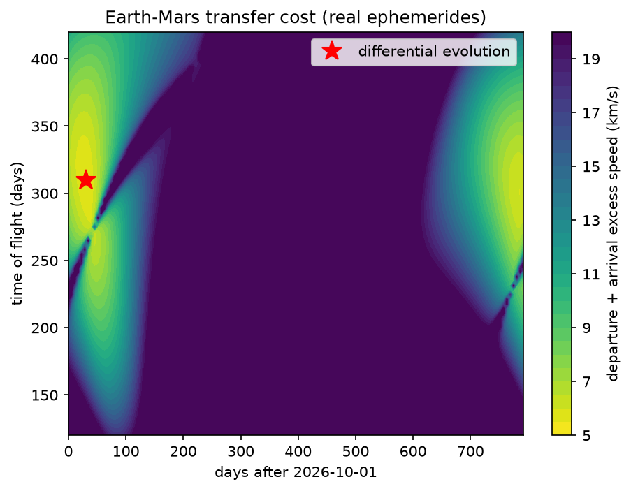
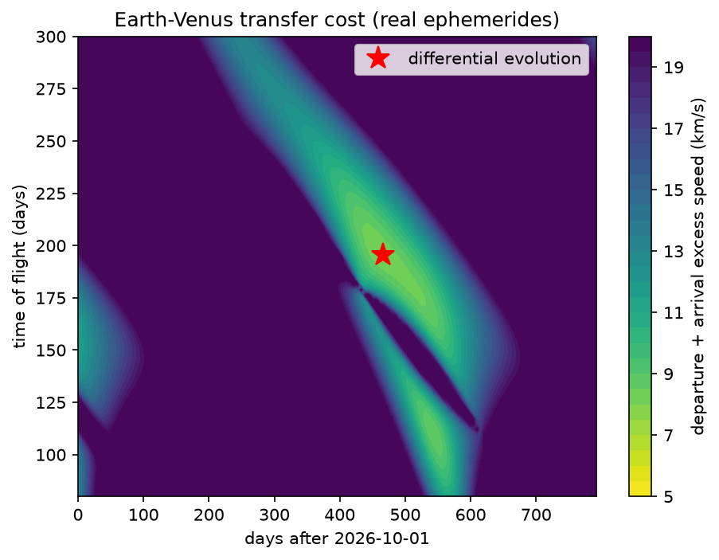
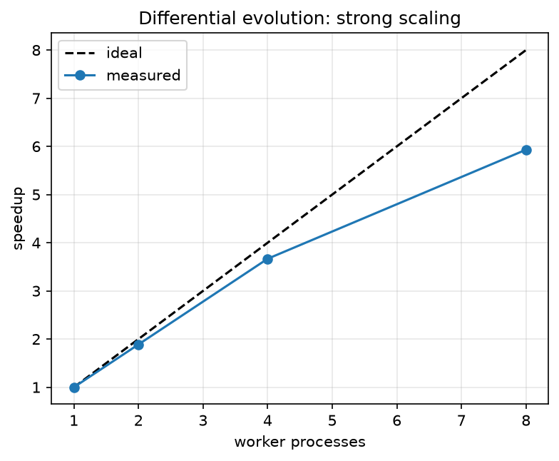

# Numerical methods for orbital mechanics

Kepler integrators, Adams-type multistep methods and global trajectory optimisation, in Python.

Python versions of the MATLAB programs from my M.Sc. thesis in Mathematics on symplectic integrators, applied to the Kepler problem. I added the Adams-type multistep methods of a numerical analysis course, a Gauss–Jackson integrator, global trajectory optimisation and a study of the statistical volume of a propagated cloud.

The MATLAB versions are in [numerical-methods-matlab](https://github.com/luigivarriale9/numerical-methods-matlab).

Implemented methods:

- Explicit Euler (order 1)
- Symplectic Euler (order 1)
- Implicit midpoint (order 2), solved with `scipy.optimize.fsolve`
- Störmer–Verlet (order 2)
- Adams–Bashforth, 1 to 4 steps (order 1 to 4)
- Adams–Moulton, 1 to 4 steps (order 2 to 5), implicit equation solved by fixed-point iteration
- ABM4 predictor–corrector in PECE form (order 5)

## Problem

Kepler problem in normalised units (mu = 1, semi-major axis a = 1) with eccentricity e = 0.7, starting from pericentre. The state is y = (x, y, vx, vy). The conserved quantities are the energy E = -0.5 and the angular momentum L = sqrt(1 - e^2). The reference is the exact solution of Kepler's equation, solved with Newton's method (`kepler_position` in `convergence.py`). DOP853 (tolerances 1e-13) provides the starting values of the multistep methods.

## Structure

- `kepler.py`: force, initial state, energy, angular momentum, the four integrators, `integrate` and the reference solution.
- `convergence.py`: convergence study. Computes the global position error at t = 3 against the exact solution for several step sizes, estimates the observed order with a log-log fit and saves `figures/convergence.png`.
- `orbits.py`: orbit comparison for e = 0.7; saves `figures/orbits.png`.
- `multistep.py`: Adams–Bashforth, Adams–Moulton and ABM4 (PECE) multistep methods.
- `multistep_convergence.py`: observed orders of the multistep methods on the Kepler problem.
- `multistep_orbits.py`: Kepler orbits computed with the multistep methods.
- `variational.py`, `variational_study.py`: variational equations and state-transition matrix for each integrator; symplecticity check and linear versus Monte Carlo covariance; saves `figures/variational_*.png`.
- `sampled_vs_linear_volume.py`: statistical volume of a propagated Gaussian cloud on the Kepler problem, sampled versus linear, with DOP853 (parallel over samples) and Störmer–Verlet (vectorised) as propagators.
- `pcr3bp.py`: planar circular restricted three-body problem (model, Hamiltonian, Jacobi constant) and the Arenstorf orbit.
- `gauss_jackson.py`: Gauss–Jackson (Störmer–Cowell) integrator for second-order problems.
- `local_optimisation.py`: Newton and gradient methods (steepest descent, conjugate gradient, least squares) for unconstrained minimisation, tested on the Rosenbrock function.
- `trajectory_optimisation.py`: global optimisation of an Earth–Mars or Earth–Venus transfer (Lambert solver and differential evolution), with a circular coplanar model and a model with real ephemerides (astropy); saves pork-chop plots in `figures/`.
- `compare_local_global.py`: comparison of a local method (L-BFGS-B from random starting points) with differential evolution on the Earth–Mars cost.
- `parallel_speedup.py`: strong-scaling test of the search with several worker processes; saves `figures/speedup.png`.
- `tests/test_kepler.py`, `tests/test_multistep.py`, `tests/test_gauss_jackson.py`, `tests/test_variational.py`, `tests/test_pcr3bp.py`, `tests/test_trajectory_optimisation.py`,`tests/test_local_optimisation.py`, `tests/test_compare_local_global.py`, `tests/test_parallel_speedup.py`, `tests/test_sampled_vs_linear_volume.py`: automated tests with pytest.
- `requirements.txt`: required libraries.

## Usage

```
python3 -m venv .venv
source .venv/bin/activate
pip install -r requirements.txt
python3 convergence.py
python3 orbits.py
python3 sampled_vs_linear_volume.py
python3 trajectory_optimisation.py mars
python3 trajectory_optimisation.py venus --start 2026-10-01 --end 2028-12-01
python3 trajectory_optimisation.py mars --model circular
pytest -v
```

## Results

### Convergence

Global position error at t = 3 for the Kepler problem (e = 0.7, pericentre start),
measured against the exact solution of Kepler's equation. All four methods use the
same step counts (n = 250 … 4000).

| Method | Observed order |
|---|---|
| Explicit Euler | 0.93 |
| Symplectic Euler | 0.95 |
| Implicit midpoint | 2.00 |
| Störmer–Verlet | 2.00 |



The final time is t = 3 rather than one full period: at t = 2π the symmetry of the
orbit hides the first-order error of symplectic Euler and the fitted order would
read about 2.

**Cross-validation.** The errors agree with the MATLAB implementation
([numerical-methods-matlab](https://github.com/luigivarriale9/numerical-methods-matlab))
to the four significant digits compared (20 values: 4 methods × 5 step counts).

### Orbits

Orbits obtained with e = 0.7, 5 orbits and 200 steps per orbit, compared with the exact ellipse (dashed). All start from pericentre.



With this relatively coarse step:

- **Explicit Euler** diverges: the energy grows at every step and the orbit opens up until it leaves the ellipse.
- **Symplectic Euler** stays bounded, but the numerical orbit is distorted with respect to the exact ellipse.
- **Implicit midpoint** keeps the shape and size of the ellipse, but the major axis rotates at every revolution (a phase error, absent in the exact problem).
- **Störmer–Verlet** is the closest to the exact orbit, with a very small precession.

Symplectic and symmetric methods do not show the systematic energy drift of explicit Euler: the dominant error is a phase error, and the energy stays bounded.

### State-transition matrix and uncertainty

`variational.py` integrates the variational equations together with the state, so that the state-transition matrix Φ = ∂x(t)/∂x₀ is available for every method. For the symplectic schemes the Jacobian of one step is written out explicitly; for explicit Euler and RK4 the method is applied to the augmented system (state and Φ, 20 equations). In every case Φ is the exact Jacobian of the numerical map, not a finite-difference estimate (checked in `tests/test_variational.py`).

The exact flow of a Hamiltonian system is symplectic: ΦᵀJΦ = J and det Φ = 1, with J = [[0, I], [−I, 0]]. This is Poincaré's theorem and the symplecticity criterion for Runge–Kutta methods (Hairer, Lubich and Wanner, ref. [1]); here it is checked numerically (e = 0.7, 20 periods, 500 steps per period, `variational_study.py`):

| Method | ‖ΦᵀJΦ − J‖ after 1 period | after 20 periods | det Φ − 1 after 20 periods |
|---|---|---|---|
| Explicit Euler | 7.7e-01 | 5.3e+02 (orbit has left the ellipse) | −2.1e-01 |
| Symplectic Euler | 1.3e-10 | 1.5e-07 | −4.5e-09 |
| Implicit midpoint | 1.1e-10 | 5.4e-09 | −5.7e-11 |
| Störmer–Verlet | 3.5e-11 | 1.1e-08 | 7.8e-12 |
| RK4 (not symplectic) | 5.1e-04 | 1.6e-01 | −1.4e-05 |



The three symplectic methods stay at the level of round-off amplified by ‖Φ‖ (about 2·10³ in spectral norm after one period for e = 0.7), whereas RK4 drifts steadily even though its trajectory is far more accurate. The matrix Φ of Störmer–Verlet converges with order 2 (observed 1.98). The values in the table are at round-off level, so their last digits change slightly between machines and library versions.

**Linear covariance.** With an initial covariance P₀ = σ²I, the linear propagation P(t) = Φ P₀ Φᵀ is compared with the sample covariance of a Monte Carlo cloud (2,000 points, exact flow computed with DOP853). The relative error stays below 10% for σ = 10⁻⁵ over the 10 periods computed, but is already 16% after 2 periods for σ = 10⁻⁴ and 78% after 1 period for σ = 10⁻³: along the orbit the cloud is stretched along-track and stops being Gaussian, because the period depends on the energy.



### Sampled versus linear statistical volume

`sampled_vs_linear_volume.py` compares two ways of computing the statistical volume √det P of an initial Gaussian cloud P₀ = σ²I on the Kepler problem (e = 0.7, pericentre start, Cartesian coordinates). The linear propagation P(t) = Φ P₀ Φᵀ has constant volume √det P₀, because det Φ = 1. The sampled volume is √det of the sample covariance of N = 2000 points propagated with the nonlinear flow. The table gives the ratio sampled / linear after one period (seed 0; the ratio at t = 0 is 1.008, which is the sampling noise of the covariance).

| σ | DOP853 | Verlet, 400 steps/period | 800 | 1600 | 3200 |
|---|---|---|---|---|---|
| 1e-10 | 1.035 | 1.026 | 1.034 | 1.035 | 1.035 |
| 1e-9 | 2.57 | 2.18 | 2.55 | 2.57 | 2.57 |
| 1e-8 | 23.7 | 19.4 | 23.5 | 23.7 | 23.7 |
| 1e-6 | 2365 | 1935 | 2349 | 2368 | 2366 |

- Up to half a period the ratio stays at the sampling-noise level (1.008) for every σ tried; it departs from it after one period, and the departure grows with σ.
- DOP853 (tolerance 1e-12, adaptive) and Störmer–Verlet agree within about 0.1% from 1600 steps per period, so the effect is not an artefact of the integrator. With 400 steps per period Verlet underestimates the ratio by about 15–18% for σ ≥ 1e-9 (the effect is too small to see at 1e-10).
- Each sample is independent. DOP853 is distributed over worker processes with `multiprocessing.Pool`. Verlet is vectorised over all samples with NumPy, not distributed over processes. `python3 sampled_vs_linear_volume.py --speedup [N]` measures the strong scaling (serial loop, 1 to 8 processes, vectorised Verlet).
  Measured with N = 4000 samples, one period and 10 logical CPUs: the serial loop takes 26.5 s. With 1, 2, 4 and 8 processes the time is 27.2, 13.8, 7.2 and 3.8 s, i.e. speedups of 0.98, 1.92, 3.71 and 6.91 (efficiency 0.98, 0.96, 0.93 and 0.86). Vectorised Verlet with 1600 steps per period takes 0.32 s: 83 times faster than the serial loop and about 12 times faster than DOP853 with 8 processes. The methods differ. Verlet has a fixed step (about 0.1% error on the Cartesian ratio at this step) and DOP853 is adaptive with tolerance 1e-12. Part of the gap is accuracy, not only vectorisation.
- In Delaunay variables (l, g, L, G), a canonical change of variables with |det J| = 1, the same cloud gives a ratio close to 1: 0.99999 for σ = 1e-8 and 1.003 for σ = 1e-6 after one period (DOP853; reference computed from the same samples at t = 0). The Kepler flow is a shear in these variables (L, G, g constant, l = l₀ + t), so the cloud stays nearly linear. This is consistent with the Cartesian growth coming from stretching along the orbit (the period depends on the energy) and curvature of the cloud. The conversion was checked by a round trip and by the Jacobian determinant.
- Verlet in Delaunay variables at σ = 1e-6 converges to DOP853 as the step is reduced (400, 800, 1600, 3200, 6400 steps per period: 1.52, 1.49, 1.06, 1.011, 1.005; DOP853: 1.003), so the difference at coarse steps is discretisation error. Over several periods the Verlet ratio in Delaunay variables drifts away from 1 (σ = 1e-8, 1600 steps: 1.04 after 5 periods, 1.92 after 10). This is accumulated phase error, not an effect of the flow.
- Checks. The DOP853 tolerance (1e-10 to 1e-13) does not change the result at σ = 1e-8. Over 10 seeds (N = 10000, Verlet, 1600 steps) the standard deviation of the Cartesian ratio is about 1.2%. In Cartesian coordinates the ratio grows roughly with the cube of the number of periods. It depends strongly on the eccentricity (σ = 1e-8, N = 500, one period, one seed): 0.99 for e = 0.1, 1.005 for e = 0.5, 23.6 for e = 0.7 and 1.3e6 for e = 0.9; in Delaunay variables 1.0 up to e = 0.7 and 1.12 for e = 0.9.
- One initial condition (pericentre start), planar problem. I did not study the effect of the initial phase.

`tests/test_sampled_vs_linear_volume.py` checks the sampling at t = 0, the energy and the period of the orbit, the shape of the propagated cloud, the linear limit, the growth with σ and the agreement between Verlet and DOP853.

### Planar circular restricted three-body problem

`pcr3bp.py` contains the model of the planar circular restricted three-body problem in the rotating frame (normalised units, μ = 0.012277471, Earth–Moon case): the equations of motion in the variables (x, y, vx, vy), the change to the canonical variables q = (x, y), p = (vx − y, vy + x), the Hamiltonian H = ½|p|² + y pₓ − x p_y − (1 − μ)/r₁ − μ/r₂ and the Jacobi constant C = −2H. The test case is the periodic Arenstorf orbit (initial data and period from Hairer, Nørsett and Wanner; the digits were checked by closing the orbit).

Checked by `tests/test_pcr3bp.py`: the canonical change of variables is invertible, H equals the energy written with the velocities, the orbit closes after one period (distance from the initial state about 1e-9 with DOP853, rtol = atol = 1e-12) and the Jacobi constant is conserved along it (variation below 1e-10 around C = 2.8564).

The comparison of explicit Euler, symplectic Euler, implicit midpoint and Störmer–Verlet on this orbit is in the MATLAB repository ([numerical-methods-matlab](https://github.com/luigivarriale9/numerical-methods-matlab)). In the rotating frame the force depends on the velocity (Coriolis term), so the classical Störmer–Verlet scheme is only first order there; a generalised scheme in canonical variables is planned but not yet implemented here.

### Multistep methods

`multistep.py` adds Adams-type linear multistep methods: Adams–Bashforth (1 to 4 steps, order 1 to 4), Adams–Moulton (1 to 4 steps, order 2 to 5, implicit equation solved by fixed-point iteration) and the predictor–corrector scheme ABM4 in PECE form (AB4 predictor, AM4 corrector). Starting values are computed with DOP853.

The observed orders on the test problem y' = -y, y(0) = 1 match the theoretical ones (checked by `tests/test_multistep.py`). On the Kepler problem (e = 0.7, position error at t = 3 against the exact solution of Kepler's equation, n = 250 … 4000 steps, `multistep_convergence.py`) the observed orders are:

| Method | AB1 | AB2 | AB3 | AB4 | AM1 | AM2 | AM3 | AM4 | ABM4 (PECE) |
|---|---|---|---|---|---|---|---|---|---|
| Observed order | 0.93 | 1.99 | 2.88 | 3.95 | 2.00 | 2.91 | 3.97 | 5.31 | 5.00 |

AB1 coincides with explicit Euler. AM4 reads slightly above 5 because its finest errors (about 4e-12) are close to the accuracy of the starting values. With 1,000 steps, ABM4 (PECE) reaches an error of about 5e-8, against about 1.3e-5 for AB4. The errors agree with the MATLAB implementation ([numerical-methods-matlab](https://github.com/luigivarriale9/numerical-methods-matlab)): 41 of the 45 values (9 methods × 5 step counts) match to four significant digits; the other four are at the finest steps, and AM4 at n = 4000 differs by about 3%.



Orbits computed with a deliberately coarse step (2 periods, 1,000 steps, `multistep_orbits.py`) show the differences in accuracy. The position error at the final time, against the exact solution, ranges from 3.4 for AB1 and 1.1 for AB2, whose orbits lose their shape, to 4.9e-3 for AM3, 1.8e-3 for ABM4 (PECE) and 1.2e-4 for AM4, which follow the exact orbit closely. At equal order, the implicit Adams–Moulton methods are more accurate than the explicit Adams–Bashforth ones.



These methods were first implemented in MATLAB for the Scientific Computing course (2023/24) and are rewritten here from the formulas.

### Gauss–Jackson integrator

`gauss_jackson.py` is a fixed-step multistep method for second-order problems y'' = f(t, y), in backward-difference form: Störmer predictor, Cowell corrector (one PECE correction, default order 8), with velocities from Adams–Bashforth–Moulton. The coefficients are generated in exact rational arithmetic from their generating functions, and the starting values come from DOP853 (rtol 1e-13).

```python
from gauss_jackson import gauss_jackson
t, Y, V = gauss_jackson(f, t0, y0, v0, h, n_steps, order=8)
```

Checked by `tests/test_gauss_jackson.py`:

- the coefficients equal the tabulated Störmer, Cowell, Adams–Bashforth and Adams–Moulton values;
- polynomial solutions are reproduced exactly;
- Kepler orbit, e = 0.7, against the exact solution (800 → 1600 steps): observed orders 6.2 for order 4 and 7.7 for order 6, i.e. about order + 2 for the position error; for order 8 the error reaches about 1e-11, the floor set by the starting values and round-off, so only the first refinement is meaningful (observed 8.5);
- 10 periods at 400 steps per period: maximum energy error 9e-7, against 1.4e-5 for classical RK4;
- J2 perturbation: the nodal precession rate matches -1.5 J2 n (R/p)^2 cos i within 2%.

This is the difference form, not the summed-ordinate form of Berry and Healy. Reference: D. A. Vallado, *Fundamentals of Astrodynamics and Applications*, Sec. 7.5.

### Global trajectory optimisation (differential evolution)

`trajectory_optimisation.py` searches the departure date and time of flight of an
Earth–Mars or Earth–Venus transfer with `scipy.optimize.differential_evolution`.
Each candidate transfer is a Lambert problem solved with universal variables.
The cost is the sum of the departure and arrival excess speeds. Two models are available:

- **Circular model**: circular coplanar planets, two-body dynamics. The minimum found
  (Mars 5.594 km/s, Venus 5.202 km/s) matches the Hohmann transfer, which validates
  the Lambert solver and the search.
- **Ephemeris model (default)**: real heliocentric positions and velocities from the
  astropy built-in ephemeris (cubic Hermite interpolation), 3D Lambert problem. In the
  departure window 2026-10-01 to 2028-12-01 the search finds, for Mars, departure
  2026-10-31, 310 days, arrival 2027-09-06, 5.61 km/s; for Venus, departure 2028-01-10,
  195 days, arrival 2028-07-24, 8.11 km/s.

The destination and the model are chosen from the command line (see Usage). The model
uses patched conics (no gravity assists, no parking orbit) and the results are not
compared with mission data. The astropy built-in ephemeris is less accurate than the
JPL ones.





The parallel and local-versus-global experiments below use the circular Earth–Mars cost.

`parallel_speedup.py` measures the strong scaling of the search with an increasing
number of worker processes. To mimic a more expensive model, the cost function is
evaluated 20 times per call (`REPS = 20`, artificial load). On a MacBook Pro with
10 cores the speedup is 1.89, 3.67 and 5.93 with 2, 4 and 8 processes (efficiency
0.94, 0.92 and 0.74). The scaling is consistent with Amdahl's law with an effective
parallel fraction of 0.95, which includes the cost of starting the processes and of
moving data.



References: see the Bibliography at the end.

### Local versus global search

`compare_local_global.py` runs a local method (`scipy.optimize.minimize`,
L-BFGS-B with finite-difference gradients) from 100 random starting points on
the Earth-Mars cost, and compares it with differential evolution.

| Method | Reaches the 5.594 km/s minimum | Evaluations |
|---|---|---|
| L-BFGS-B, 100 random starts | 57 of 100 | about 80 per run |
| Differential evolution | always (4 seeds) | 6000-12000 per run |

The local method is much cheaper but depends on the starting point; the worst
run ends at 10.47 km/s. Differential evolution costs more evaluations and finds
the minimum from any seed. The local method here is SciPy's, not the one from
`local_optimisation.py`, because the cost function has no analytic gradient or Hessian.

### Local optimisation (Newton and gradient methods)

`local_optimisation.py` is a Python version of the methods from the
Scientific Computing labs 7-9 (originally written in MATLAB):
Newton, Newton with Armijo backtracking, steepest descent with Armijo
backtracking, steepest descent with exact line search, conjugate gradient
(the last two for symmetric positive definite linear systems) and conjugate
gradient for least squares problems.

On the Rosenbrock function from (-1.2, 1), tolerance 1e-6 on the gradient norm:

| Method | Iterations |
|---|---|
| Newton | 6 |
| Newton + Armijo, step never reset | 174 |
| Newton + Armijo, step reset to 1 at every iteration | 21 |
| Steepest descent + Armijo | 32847 |

A local method needs a good starting point; the global search above
(differential evolution) does not.

## Tests

The repository has 68 automated tests (`pytest`): orders of convergence of the integrators, multistep methods, the Gauss–Jackson integrator, the state-transition matrix, the restricted three-body model, the Lambert problem and global optimisation (circular and real-ephemeris models), the parallel speedup experiment, the local optimisation methods, the local versus global comparison and the sampled versus linear volume study. They run on every push with GitHub Actions.

## Possible extensions

- Comparison with the MATLAB implementations beyond the convergence studies (long-time energy and angular momentum).
- Study of other eccentricities and longer integration times for the integrator comparison (the volume study already covers e = 0.1 to 0.9, indicatively, and up to 10 periods).
- Sampled versus linear volume with a non-conservative force (drag), where det Φ is no longer 1, and other initial phases.
- Integrators of this repository on the restricted three-body problem: generalised Störmer–Verlet scheme for the Coriolis term, and Gauss–Jackson in the inertial frame.

## Bibliography

**Symplectic and numerical integration**

1. E. Hairer, C. Lubich, G. Wanner, *Geometric Numerical Integration*, Springer (2006). Symplectic methods, Störmer–Verlet, symplecticity of the flow and of Runge–Kutta methods.
2. E. Hairer, S. P. Nørsett, G. Wanner, *Solving Ordinary Differential Equations I: Nonstiff Problems*, Springer (1987). Arenstorf orbit and DOP853, used as reference integrator.
3. H. Goldstein, C. Poole, J. Safko, *Classical Mechanics* (Italian edition: *Meccanica Classica*, 2nd ed., Pearson Education, 2002). Hamiltonian formulation and canonical variables.
4. Lectures and laboratories of the Scientific Computing course (Università di Napoli Federico II, 2023/24): Adams-type multistep methods and local optimisation methods.

**Astrodynamics**

5. D. A. Vallado, with technical contributions by W. D. McClain, *Fundamentals of Astrodynamics and Applications*, Space Technology Series, McGraw-Hill (1997). Integrators and the Gauss–Jackson method (Sec. 7.5), variational equations (Sec. 9.5.3), Lambert's problem.
6. R. R. Bate, D. D. Mueller, J. E. White, *Fundamentals of Astrodynamics*, Dover (1971). Kepler problem and Kepler's equation.
7. M. M. Berry, L. M. Healy, "Implementation of Gauss–Jackson integration for orbit propagation", *Journal of the Astronautical Sciences* 52 (2004), 331–357. Summed-ordinate form of the method, which is not implemented here.
8. H. D. Curtis, *Orbital Mechanics for Engineering Students*, Butterworth-Heinemann. Lambert's problem with universal variables, Hohmann transfer.
9. R. F. Arenstorf, "Periodic solutions of the restricted three body problem representing analytic continuations of Keplerian elliptic motions", *American Journal of Mathematics* 85 (1963), 27–35.
10. W. S. Koon, M. W. Lo, J. E. Marsden, S. D. Ross, *Dynamical Systems, the Three-Body Problem and Space Mission Design* (2006). Restricted three-body problem and Jacobi constant.
11. J. D. Cook, "Arenstorf orbit", blog post, 8 February 2020 (https://www.johndcook.com/blog/2020/02/08/arenstorf-orbit/). Source of the initial data digits.

**Optimisation and parallel computing**

12. R. Storn, K. Price, "Differential evolution – a simple and efficient heuristic for global optimization over continuous spaces", *Journal of Global Optimization* 11 (1997), 341–359.
13. R. H. Byrd, P. Lu, J. Nocedal, C. Zhu, "A limited memory algorithm for bound constrained optimization", *SIAM Journal on Scientific Computing* 16 (1995), 1190–1208 (L-BFGS-B).
14. L. Armijo, "Minimization of functions having Lipschitz continuous first partial derivatives", *Pacific Journal of Mathematics* 16 (1966), 1–3.
15. G. M. Amdahl, "Validity of the single processor approach to achieving large scale computing capabilities", *AFIPS Conference Proceedings* 30 (1967), 483–485.

**Software**

16. P. Virtanen et al., "SciPy 1.0: fundamental algorithms for scientific computing in Python", *Nature Methods* 17 (2020), 261–272.
17. C. R. Harris et al., "Array programming with NumPy", *Nature* 585 (2020), 357–362.
18. Astropy Collaboration, "The Astropy Project: sustaining and growing a community-oriented open-source project and the latest major release (v5.0) of the core package", *The Astrophysical Journal* 935 (2022), 167. Built-in ephemeris.
19. J. D. Hunter, "Matplotlib: a 2D graphics environment", *Computing in Science & Engineering* 9 (2007), 90–95.
